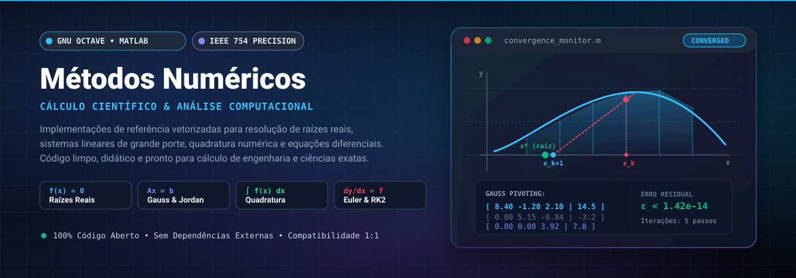
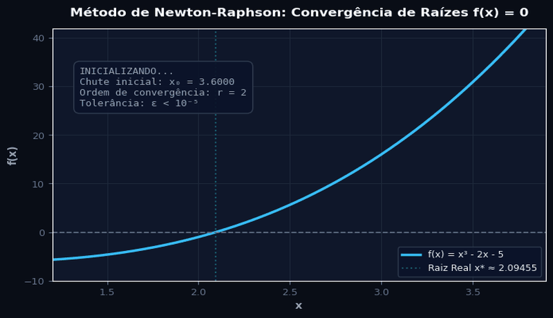
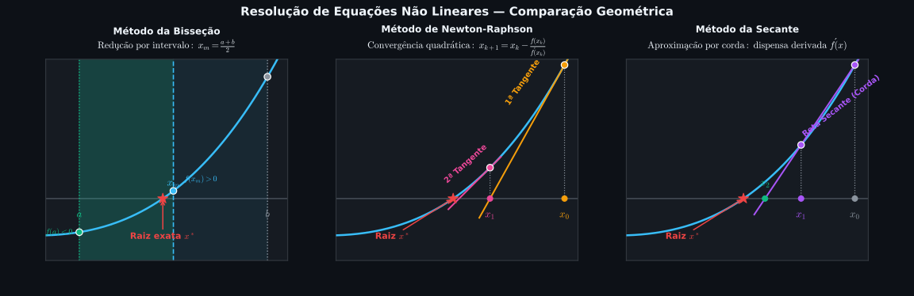
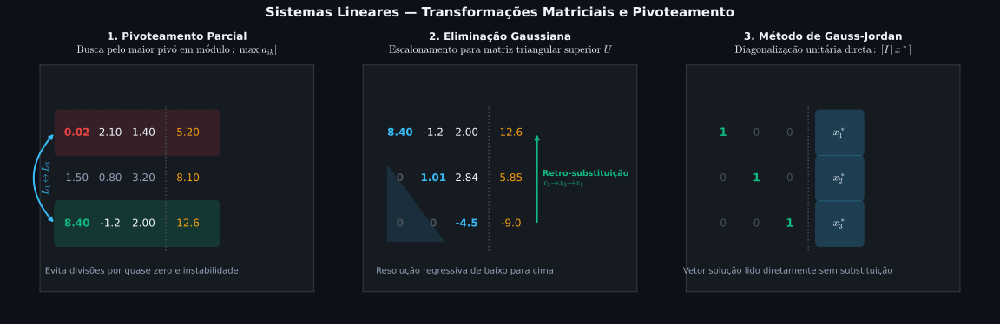
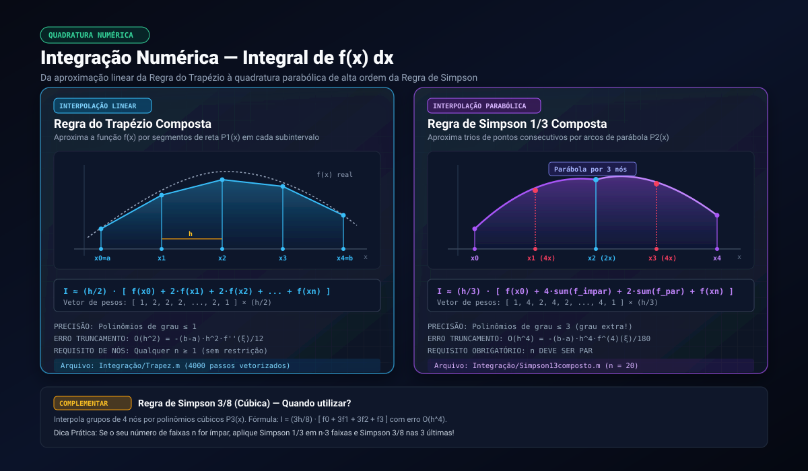

# 🧮 Métodos Numéricos — GNU Octave / MATLAB

<p align="center">
  
</p>

<p align="center">
  
  
  
  
  
</p>

<p align="center">
  
</p>

Repositório científico de referência técnica e consulta imediata para implementação, estudo e aplicação de **Métodos Numéricos e Computação Científica** em ambientes **GNU Octave** e **MathWorks MATLAB**. 

Todos os códigos foram integralmente refatorados com foco em estabilidade assintótica, clareza algorítmica, nomenclatura autoexplicativa, supressão de divergências numéricas, conformidade estrita com o padrão IEEE 754 e ausência de dependências proprietárias externas.

---

## 📑 Sumário Executivo

1. [⚡ Guia de Busca Rápida: "Quero Fazer X → Use Tal Método"](#-guia-de-busca-rápida-quero-fazer-x--use-tal-método)
2. [🗺️ Mapa Arquitetural do Repositório](#️-mapa-arquitetural-do-repositório)
3. [▶️ Como Executar e Ambientes Suportados](#️-como-executar-e-ambientes-suportados)
4. [🎯 1. Raízes de Equações Não Lineares ($f(x) = 0$)](#-1-raízes-de-equações-não-lineares-fx--0)
5. [🧱 2. Sistemas de Equações Lineares ($Ax = b$)](#-2-sistemas-de-equações-lineares-ax--b)
6. [∫ 3. Integração Numérica (Quadratura de Newton-Cotes)](#-3-integração-numérica-quadratura-de-newton-cotes)
7. [📐 4. Diferenciação Numérica e Diferenças Finitas](#-4-diferenciação-numérica-e-diferenças-finitas)
8. [📈 5. Equações Diferenciais Ordinárias (PVI)](#-5-equações-diferenciais-ordinárias-pvi)
9. [🔁 6. Séries de Funções e Aproximações Polinomiais](#-6-séries-de-funções-e-aproximações-polinomiais)
10. [〰️ 7. Processamento de Sinais e Métricas Estatísticas](#️-7-processamento-de-sinais-e-métricas-estatísticas)
11. [⚗️ 8. Físico-Química e Modelagem Molecular](#️-8-físico-química-e-modelagem-molecular)
12. [💊 9. Farmacocinética e Modelagem Compartimental](#-9-farmacocinética-e-modelagem-compartimental)
13. [🛠️ 10. Utilitários, Conversões e Visualização Gráfica](#️-10-utilitários-conversões-e-visualização-gráfica)
14. [🛡️ Guia Fundamental de Boas Práticas Numéricas](#️-guia-fundamental-de-boas-práticas-numéricas)
15. [🔍 Histórico de Correções Críticas da Refatoração](#-histórico-de-correções-críticas-da-refatoração)
16. [📋 Guia Sintático Octave vs. MATLAB](#-guia-sintático-octave-vs-matlab)

---

## ⚡ Guia de Busca Rápida: "Quero Fazer X → Use Tal Método"

Consulte o fluxo de decisão a seguir para determinar instantaneamente a rota algorítmica ótima para seu problema de engenharia ou cálculo científico:

<p align="center">
  
</p>

### 📊 Tabela Mestra de Decisão

| O que você quer calcular? | Método Recomendado | O que precisa ter (Entradas) | O que entrega (Saídas) | Arquivo no Repositório |
|---|---|---|---|---|
| Raiz real com garantia de convergência em intervalo com troca de sinal | **Bisseção** | Função contínua $f(x)$, intervalo $[a, b]$ com $f(a) \cdot f(b) < 0$, tolerância | Raiz aproximada, tabela iterativa passo a passo, resíduo $\|f(x)\|$ | [`raizes_equacoes/bissecao.m`](raizes_equacoes/bissecao.m) |
| Raiz em intervalo com interpolação linear rápida | **Falsa Posição (Regula Falsi)** | Função contínua $f(x)$, intervalo $[a, b]$ com $f(a) \cdot f(b) < 0$, tolerância | Raiz estimada, erro relativo entre retas secantes, tabela | [`raizes_equacoes/falsa_posicao.m`](raizes_equacoes/falsa_posicao.m) |
| Raiz de altíssima convergência (quadrática) com derivada analítica disponível | **Newton-Raphson** | $f(x)$, derivada analítica $f'(x)$, chute inicial $x_0$ próximo da raiz | Raiz refinada, taxa de convergência quadrática, tabela | [`raizes_equacoes/newton_raphson.m`](raizes_equacoes/newton_raphson.m) |
| Raiz rápida sem calcular derivada analítica nem troca de sinal prévia | **Secante** | Função $f(x)$, duas estimativas iniciais $x_0$ e $x_1$, tolerância | Raiz aproximada (ordem $\approx 1{,}618$), histórico de iterações | [`raizes_equacoes/secante.m`](raizes_equacoes/secante.m) |
| Raiz transformando $f(x) = 0$ na forma equivalente $x = g(x)$ | **Ponto Fixo (Picard-Banach)** | Função $g(x)$ com $\|g'(x)\| < 1$ na vizinhança da raiz, chute $x_0$ | Ponto fixo $x^*$, verificação de contração, tabela iterativa | [`raizes_equacoes/ponto_fixo.m`](raizes_equacoes/ponto_fixo.m) |
| Solução de sistema linear determinado $Ax = b$ com máxima estabilidade numérica | **Eliminação de Gauss com Pivoteamento Parcial** | Matriz de coeficientes $A$ ($n \times n$), vetor $b$ ($n \times 1$) | Matriz triangular superior, vetor solução $x$, resíduo $\|Ax-b\|_2$ | [`sistemas_lineares/gauss_pivoteamento.m`](sistemas_lineares/gauss_pivoteamento.m) |
| Diagonalização direta e leitura imediata da solução do sistema | **Gauss-Jordan com Normalização** | Matriz $A$ ($n \times n$), vetor de termos independentes $b$ | Matriz identidade $[I \mid x]$, solução desacoplada, resíduo | [`sistemas_lineares/gauss_jordan.m`](sistemas_lineares/gauss_jordan.m) |
| Integral definida de função genérica ou dados tabulados | **Regra do Trapézio Composta** | Integrando $f(x)$, limites $[a, b]$, número de intervalos $n$ | Valor aproximado da integral, passo $h$, erro de ordem $O(h^2)$ | [`integracao_numerica/trapezio_composto.m`](integracao_numerica/trapezio_composto.m) |
| Integral definida de alta ordem de exatidão | **Simpson 1/3 Composta** | Integrando $f(x)$, limites $[a, b]$, número **par** de intervalos $n$ | Quadratura numérica refinada, erro de truncamento $O(h^4)$ | [`integracao_numerica/simpson_13_composto.m`](integracao_numerica/simpson_13_composto.m) |
| Derivada primeira de dados discretos ou função contínua | **Diferença Finita Progressiva 3 Pontos** | Vetor amostral $y$ ou função $f(x)$, espaçamento uniforme $h$ | Vetor com aproximação de $f'(x)$ de ordem $O(h^2)$ | [`diferenciacao_numerica/diferenca_progressiva_3pontos.m`](diferenciacao_numerica/diferenca_progressiva_3pontos.m) |
| Solução de PVI escalar explícito de primeira ordem | **Euler Explícito** | EDO $y' = f(x, y)$, condição $y(x_0) = y_0$, passo $h$, intervalo | Vetores $x$ e $y_{num}$, tabela comparativa, gráfico analítico vs. numérico | [`equacoes_diferenciais/euler_explicito.m`](equacoes_diferenciais/euler_explicito.m) |
| EDO não linear ou problema rígido (*stiff*) com estabilidade incondicional | **Euler Implícito + Newton-Raphson** | EDO $y' = f(x, y)$, jacobiana $\partial f/\partial y$, condição inicial | Solução $A$-estável sem explosão numérica, resíduos iterativos | [`equacoes_diferenciais/euler_implicito_newton.m`](equacoes_diferenciais/euler_implicito_newton.m) |
| PVI escalar com precisão de segunda ordem | **Runge-Kutta 2 (Heun Escalar)** | EDO $y' = f(x, y)$, condição inicial $y(x_0) = y_0$, passo $h$ | Malha de pontos, predição e correção trapezoidal $O(h^2)$ | [`equacoes_diferenciais/rk2_individual.m`](equacoes_diferenciais/rk2_individual.m) |
| Sistema acoplado de 2 EDOs de primeira ordem | **Runge-Kutta 2 (Heun para Sistemas)** | $y' = f(x, y, z)$, $z' = g(x, y, z)$, condições $y(x_0), z(x_0)$, $h$ | Curvas temporais simultâneas $y(x)$ e $z(x)$, gráfico de estados | [`equacoes_diferenciais/rk2_heun_sistema.m`](equacoes_diferenciais/rk2_heun_sistema.m) |
| Avaliação analítica de cosseno via expansão polinomial | **Série de Taylor / Maclaurin** | Ângulo $x$ (radianos), número de termos da expansão polinomial | Aproximação numérica, erro relativo comparado ao valor real | [`series_aproximacoes/taylor_cosseno.m`](series_aproximacoes/taylor_cosseno.m) |
| Síntese de ondas periódicas e cálculo de valor médio e RMS | **Gerador de Sinais e Cálculo de RMS** | Frequências, amplitudes, offsets DC, frequência de amostragem | Ondas senoidal, quadrada e triangular; valores médios e eficazes | [`processamento_sinais/gerador_sinais_rms.m`](processamento_sinais/gerador_sinais_rms.m) |
| Energia reticular cristalina via modelo eletrostático/quântico | **Equação de Born-Mayer** | Valências iônicas $z_+, z_-$, constante de Madelung, raios iônicos | Energia de rede $U$ (kJ/mol), separação coulombiana e Pauli | [`fisico_quimica/born_mayer_energia_reticular.m`](fisico_quimica/born_mayer_energia_reticular.m) |
| Momento magnético *spin-only* e susceptibilidade molar | **Equação de Curie / Spin Puro** | Quantidade de elétrons desemparelhados $n$, temperatura $T$ (K) | Momento $\mu_{so}$ ($\mu_B$), susceptibilidade magnética molar $\chi_M$ | [`fisico_quimica/susceptibilidade_magnetica.m`](fisico_quimica/susceptibilidade_magnetica.m) |
| Problema inverso: elétrons desemparelhados a partir da susceptibilidade | **Resolução Polinomial Magnetoquímica** | Susceptibilidade magnética molar $\chi_M$, temperatura $T$ (K) | Número inteiro de elétrons $n$, raízes físicas do polinômio | [`fisico_quimica/eletrons_desemparelhados.m`](fisico_quimica/eletrons_desemparelhados.m) |
| Cinética de fármaco em doses repetidas em bolus instantâneo | **Farmacocinética sem Absorção** | Dose, intervalo posológico $\tau$, meia-vida de eliminação $t_{1/2}$ | Perfil plasmático temporal, média móvel, fator de acúmulo no platô | [`farmacocinetica/concentracao_dose_instantanea.m`](farmacocinetica/concentracao_dose_instantanea.m) |
| Cinética com fase de absorção e liberação contínua | **Farmacocinética com Absorção** | Dose, taxa de absorção $k_a$, meia-vida, intervalo posológico | Curva plasmática suave, concentração de pico e platô estacionário | [`farmacocinetica/concentracao_com_absorcao.m`](farmacocinetica/concentracao_com_absorcao.m) |
| Otimização posológica e acúmulo no equilíbrio | **Estudo Paramétrico Intervalo/Meia-Vida** | Meia-vida, dose padrão, vetor de intervalos de administração | Curva do fator de acúmulo em função da razão adimensional $\tau/t_{1/2}$ | [`farmacocinetica/estudo_intervalo_meia_vida.m`](farmacocinetica/estudo_intervalo_meia_vida.m) |
| Conversão de unidades físicas de engenharia SI ↔ Imperial | **Conversor SI / Imperial** | Massa em quilogramas [kg] e comprimento em metros [m] | Estrutura com libras [lb], onças [oz], polegadas [in], pés [ft] e jardas | [`utilitarios/conversao_si_imperial.m`](utilitarios/conversao_si_imperial.m) |
| Diagnóstico de matrizes e resolução de expressões complexas | **Álgebra Linear e Expressões Aritméticas** | Valores numéricos escalares ou matriz quadrada inteira | Determinante, inverso $A^{-1}$, número de condicionamento $\kappa(A)$ | [`utilitarios/operacoes_matrizes.m`](utilitarios/operacoes_matrizes.m) |
| Visualização geométrica e cálculo de pontos críticos | **Visualizador Gráfico de Funções** | Equação da catenária ou polinômios de quadratura de Gauss | Gráficos formatados com vértices, raízes e tangentes | [`utilitarios/plotar_funcao.m`](utilitarios/plotar_funcao.m) |

---

## 🗺️ Mapa Arquitetural do Repositório

O projeto adota estrutura modular canônica, onde cada categoria científica possui seu próprio diretório autossuficiente:

```text
MetodosNumericos/
├── assets/                                 # 🎨 Recursos gráficos, diagramas SVG vetoriais e animações
│   ├── banner_topo.svg / .png              # Banner superior de apresentação
│   ├── animacao_convergencia.gif           # GIF animado de convergência iterativa
│   ├── diagrama_fluxo_decisao.svg / .png   # Árvore de decisão para escolha de algoritmos
│   ├── diagrama_raizes.svg / .png          # Diagrama conceitual de raízes de equações
│   ├── diagrama_sistemas.svg / .png        # Diagrama de decomposição e escalonamento linear
│   └── diagrama_integracao.svg / .png      # Diagrama de partição geométrica de integração
│
├── raizes_equacoes/                        # 🎯 Resolução de equações não lineares escalares f(x) = 0
│   ├── bissecao.m                          # Bisseção intervalar (Teorema de Bolzano)
│   ├── falsa_posicao.m                     # Falsa Posição (Regula Falsi com interpolação linear)
│   ├── newton_raphson.m                    # Newton-Raphson com convergência quadrática
│   ├── ponto_fixo.m                        # Iteração de Ponto Fixo (Picard-Banach)
│   └── secante.m                           # Método da Secante com estimativa de derivadas finitas
│
├── sistemas_lineares/                      # 🧱 Resolução direta de sistemas algébricos Ax = b
│   ├── gauss_pivoteamento.m                # Eliminação Gaussiana com pivoteamento parcial e substituição
│   └── gauss_jordan.m                      # Método de Gauss-Jordan com normalização diagonal unitária
│
├── integracao_numerica/                    # ∫ Quadratura numérica de Newton-Cotes
│   ├── trapezio_composto.m                 # Regra do Trapézio Composta (convergência O(h²))
│   └── simpson_13_composto.m               # Regra de Simpson 1/3 Composta (convergência O(h⁴))
│
├── diferenciacao_numerica/                 # 📐 Aproximação de derivadas por diferenças finitas
│   └── diferenca_progressiva_3pontos.m     # Fórmula Progressiva de 3 Pontos (convergência O(h²))
│
├── equacoes_diferenciais/                  # 📈 Problemas de Valor Inicial (PVI) para EDOs
│   ├── euler_explicito.m                   # Euler Explícito de 1º ordem
│   ├── euler_implicito_newton.m            # Euler Implícito incondicionalmente estável + Newton-Raphson
│   ├── rk2_individual.m                    # Runge-Kutta de 2ª ordem (Heun) para EDO escalar
│   └── rk2_heun_sistema.m                  # Runge-Kutta de 2ª ordem para sistema acoplado de 2 EDOs
│
├── series_aproximacoes/                    # 🔁 Séries analíticas e aproximações de funções
│   └── taylor_cosseno.m                    # Expansão em Série de Taylor/Maclaurin para cos(x)
│
├── processamento_sinais/                   # 〰️ Síntese de formas de onda e análise harmônica
│   ├── gerador_sinais_rms.m                # Geração de senoidal, quadrada, triangular e cálculo de RMS
│   └── workspace_senoide_exemplo.mat       # Matriz e dados pré-computados de amostragem
│
├── fisico_quimica/                         # ⚗️ Termodinâmica iônica e magnetoquímica quântica
│   ├── born_mayer_energia_reticular.m      # Equação de Born-Mayer para cristais iônicos
│   ├── susceptibilidade_magnetica.m        # Momento magnético e Lei de Curie para íons de transição
│   └── eletrons_desemparelhados.m          # Problema inverso: determinação de n a partir de χ_M
│
├── farmacocinetica/                        # 💊 Modelagem compartimental de fármacos e posologia
│   ├── concentracao_dose_instantanea.m     # Modelo monocompartimental em bolus sem absorção
│   ├── concentracao_com_absorcao.m         # Cinética de 1ª ordem com taxa contínua de absorção
│   └── estudo_intervalo_meia_vida.m        # Varredura paramétrica do acúmulo no platô estacionário
│
├── utilitarios/                            # 🛠️ Ferramentas auxiliares e rotinas matemáticas
│   ├── conversao_si_imperial.m             # Função de conversão precisa SI ↔ Imperial
│   ├── operacoes_matrizes.m                # Álgebra linear, precedência e condicionamento matricial
│   └── plotar_funcao.m                     # Visualização comparativa de catenárias e polinômios
│
└── README.md                               # 📖 Este manual técnico completo de referência
```

---

## ▶️ Como Executar e Ambientes Suportados

Os scripts foram desenvolvidos primariamente para **GNU Octave** (versão 6.4 ou superior) e são integralmente compatíveis com **MathWorks MATLAB** (R2020b ou superior).

### 🐧 Execução via Terminal Linux / macOS (Octave CLI)

Para executar qualquer rotina diretamente sem carregar a interface gráfica:

```bash
# Navegue até a raiz do repositório
cd /dev/shm/MetodosNumericos

# Execução individual de um script
octave --no-gui "raizes_equacoes/bissecao.m"
octave --no-gui "sistemas_lineares/gauss_pivoteamento.m"
octave --no-gui "equacoes_diferenciais/euler_implicito_newton.m"
```

### 🖥️ Execução via Interface Gráfica (Octave GUI ou MATLAB)

1. Abra o GNU Octave ou o MATLAB.
2. Defina a pasta corrente como a raiz do projeto (`/dev/shm/MetodosNumericos`).
3. Abra o arquivo desejado no Editor de Código.
4. Pressione **F5** (ou clique no botão **Run**).
5. Os gráficos serão instanciados em janelas independentes e as tabelas numéricas serão impressas formatadas no terminal.

### 📦 Dependências e Toolboxes

- **GNU Octave:** Todas as rotinas numéricas utilizam apenas o núcleo básico (*core*). Para síntese de formas de onda em `processamento_sinais/gerador_sinais_rms.m`, o código já possui rotinas analíticas nativas embutidas, funcionando perfeitamente sem exigir a instalação de pacotes externos. Se desejar instalar a biblioteca opcional do ecossistema Forge:
  ```octave
  pkg install -forge signal
  pkg load signal
  ```
- **MATLAB:** Não requer nenhuma toolbox adicional paga (dispensa Signal Processing Toolbox ou Symbolic Math Toolbox).

---

## 🎯 1. Raízes de Equações Não Lineares ($f(x) = 0$)

A determinação de raízes de equações transcendentais e algébricas consiste em encontrar $x^* \in \mathbb{R}$ tal que $f(x^*) = 0$.

<p align="center">
  
</p>

### Comparativo Técnico entre Métodos de Raiz

| Algoritmo | Ordem de Convergência | Requisitos de Entrada | Garantia de Convergência | Custo por Iteração |
|---|---|---|---|---|
| **Bisseção** | Linear ($\approx 1{,}0$) | Intervalo $[a, b]$ com $f(a) \cdot f(b) < 0$ | Globalmente convergente | 1 avaliação funcional |
| **Falsa Posição** | Superlinear | Intervalo $[a, b]$ com $f(a) \cdot f(b) < 0$ | Globalmente convergente | 1 avaliação funcional |
| **Ponto Fixo** | Linear ($1{,}0$) | Função $g(x)$ e estimativa inicial $x_0$ | Local ($\|g'(x)\| < 1$) | 1 avaliação funcional |
| **Secante** | Superlinear ($\approx 1{,}618$) | Dois chutes iniciais $x_0$ e $x_1$ | Local | 1 avaliação funcional |
| **Newton-Raphson** | Quadrática ($2{,}0$) | Chute inicial $x_0$ e derivada $f'(x)$ | Local ($f'(x^*) \neq 0$) | 2 avaliações ($f$ e $f'$) |

---

### 1.1 Método da Bisseção
- **Arquivo:** [`raizes_equacoes/bissecao.m`](raizes_equacoes/bissecao.m)
- **O que calcula:** Determina a raiz $x^*$ em um intervalo fechado $[a, b]$ com base no Teorema de Bolzano. A cada passo, calcula o ponto médio:
  $$x_m = \frac{a + b}{2}$$
  Atualiza o subintervalo verificando o sinal do produto $f(a) \cdot f(x_m)$. O limitante superior do erro absoluto na iteração $k$ é:
  $$\varepsilon_k = \frac{b_0 - a_0}{2^k}$$
- **O que entrega:** Tabela formatada (`Iteração | Limite Inferior | Limite Superior | Ponto Médio | f(Ponto Médio) | Erro Estimado`), raiz refinada final e contador de iterações.
- **O que precisa ter:** Função contínua $f(x)$, extremos $a$ e $b$ com $f(a) \cdot f(b) < 0$, tolerância de parada e limite de iterações.
- **Exemplo e Resultado Esperado:**
  - Parâmetros padrão: $f(x) = x^2 - e^{-x}$, intervalo $[0{,}0, \; 1{,}0]$, tolerância $\varepsilon = 10^{-4}$, $i_{max} = 100$.
  - Resultado numérico obtido: **$\text{Raiz} \approx 0{,}703491$** obtida em **14 iterações** com erro absoluto $< 6{,}10 \times 10^{-5}$.

---

### 1.2 Método da Falsa Posição (Regula Falsi)
- **Arquivo:** [`raizes_equacoes/falsa_posicao.m`](raizes_equacoes/falsa_posicao.m)
- **O que calcula:** Interpola linearmente a curva entre $(a, f(a))$ e $(b, f(b))$, calculando o zero da reta secante correspondente:
  $$x_r = \frac{a \cdot f(b) - b \cdot f(a)}{f(b) - f(a)} = b - \frac{f(b) \cdot (b - a)}{f(b) - f(a)}$$
- **O que entrega:** Tabela detalhada passo a passo, raiz final convergida, verificação contínua dos sinais $f(a)$ e $f(b)$ a cada iteração (corrigindo o bug histórico das versões legadas) e erro relativo entre sucessivos pontos interpolados.
- **O que precisa ter:** $f(x)$ contínua, $f(a) \cdot f(b) < 0$, tolerância $\varepsilon$.
- **Exemplo e Resultado Esperado:**
  - Parâmetros padrão: $f(x) = x^2 - e^{-x}$, intervalo $[0{,}0, \; 1{,}0]$, tolerância $\varepsilon = 10^{-4}$.
  - Resultado numérico obtido: **$\text{Raiz} \approx 0{,}703467$** convergindo em apenas **5 iterações**.

---

### 1.3 Método de Newton-Raphson (Método das Tangentes)
- **Arquivo:** [`raizes_equacoes/newton_raphson.m`](raizes_equacoes/newton_raphson.m)
- **O que calcula:** Utiliza a expansão em Série de Taylor de primeira ordem em torno do ponto corrente $x_k$:
  $$x_{k+1} = x_k - \frac{f(x_k)}{f'(x_k)}$$
  Apresenta convergência quadrática nas imediações de raízes simples onde $f'(x^*) \neq 0$.
- **O que entrega:** Tabela de iterações com valores de $x_k$, $f(x_k)$, $f'(x_k)$, $x_{k+1}$ e erro relativo percentual, diagnóstico de convergência e alerta automático para derivadas nulas ($f'(x_k) \approx 0$).
- **O que precisa ter:** Função $f(x)$, expressão analítica da derivada $f'(x)$, chute inicial $x_0$ e tolerância.
- **Exemplo e Resultado Esperado:**
  - Parâmetros padrão: $f(x) = x^3 + 3{,}8x^2 - 8{,}6x - 24{,}4$, com $f'(x) = 3x^2 + 7{,}6x - 8{,}6$, estimativa inicial $x_0 = 4{,}0$, tolerância $\varepsilon = 10^{-6}$.
  - Resultado numérico obtido: **$\text{Raiz} \approx 2{,}706938$** convergindo em **5 iterações** com resíduo $\|f(x)\| < 1{,}42 \times 10^{-13}$.

---

### 1.4 Método da Secante
- **Arquivo:** [`raizes_equacoes/secante.m`](raizes_equacoes/secante.m)
- **O que calcula:** Substitui a derivada formal de Newton pela aproximação de diferenças finitas baseada nas duas iterações mais recentes:
  $$x_{k+1} = x_k - f(x_k) \cdot \frac{x_k - x_{k-1}}{f(x_k) - f(x_{k-1})}$$
  Não requer cálculo analítico de derivadas nem preservação estrita de troca de sinal. Ordem assintótica $\alpha = \frac{1 + \sqrt{5}}{2} \approx 1{,}618$.
- **O que entrega:** Tabela formatada das iterações, valor da raiz aproximada final, erro relativo percentual rigoroso com proteção em módulo `abs((x_k - x_{k-1})/x_k)`.
- **O que precisa ter:** Função $f(x)$, duas estimativas $x_0$ e $x_1$ suficientemente próximas, tolerância e número máximo de iterações.
- **Exemplo e Resultado Esperado:**
  - Parâmetros padrão: $f(x) = 2x^3 - 11{,}7x^2 + 17{,}7x - 5$, chutes iniciais $x_0 = 0{,}0$ e $x_1 = 1{,}0$, tolerância $\varepsilon = 10^{-3}$.
  - Resultado numérico obtido: **$\text{Raiz} \approx 0{,}365099$** em **7 iterações**.

---

### 1.5 Método do Ponto Fixo (Iteração Linear de Picard-Banach)
- **Arquivo:** [`raizes_equacoes/ponto_fixo.m`](raizes_equacoes/ponto_fixo.m)
- **O que calcula:** Transforma algebricamente $f(x) = 0$ na relação equivalente $x = g(x)$. A convergência para o ponto fixo único $x^*$ é garantida pelo Teorema da Contração se:
  $$|g'(x)| \le L < 1, \quad \forall x \in [a, b]$$
  Relação de recorrência: $x_{k+1} = g(x_k)$.
- **O que entrega:** Tabela de iterações comparando $x_k$, $g(x_k)$, resíduo $\|f(x_{k+1})\|$, variação absoluta e diagnósticos de divergência.
- **O que precisa ter:** Função de iteração $g(x)$, estimativa inicial $x_0$ no intervalo de contração e tolerância.
- **Exemplo e Resultado Esperado:**
  - Parâmetros padrão: $f(x) = e^x - 4x^2 \implies g(x) = 0{,}5 \cdot e^{0{,}5x}$, chute inicial $x_0 = 0{,}5$, tolerância $\varepsilon = 10^{-3}$.
  - Resultado numérico obtido: **$\text{Raiz} \approx 0{,}714393$** em **6 iterações**.

> [!TIP]
> **Validação Nativa Rápida:** No console do Octave/MATLAB, você pode checar qualquer raiz usando:
> ```octave
> fzero(@(x) x.^2 - exp(-x), [0, 1])   % Raiz intervalar
> roots([1, 3.8, -8.6, -24.4])         % Todas as raízes polinomiais
> ```

---

## 🧱 2. Sistemas de Equações Lineares ($Ax = b$)

Resolução de sistemas lineares determinados de ordem $n$ da forma matricial:
$$A \mathbf{x} = \mathbf{b}$$

<p align="center">
  
</p>

### 2.1 Eliminação Gaussiana com Pivoteamento Parcial e Retrossubstituição
- **Arquivo:** [`sistemas_lineares/gauss_pivoteamento.m`](sistemas_lineares/gauss_pivoteamento.m)
- **O que calcula:** Transforma a matriz original em uma matriz triangular superior equivalente através de combinações lineares entre linhas. Para mitigar erros de arredondamento causados por pivôs pequenos, realiza a troca sistemática de linhas:
  $$p = \arg\max_{l=k,\dots,n} |a_{lk}| \implies \text{Troca linha } k \leftrightarrow \text{linha } p$$
  Elimina os elementos abaixo do pivô via multiplicador $m_{ik} = \frac{a_{ik}}{a_{kk}}$. Em seguida, resolve as incógnitas por retrossubstituição regressiva:
  $$x_n = \frac{b_n}{a_{nn}}, \quad x_i = \frac{b_i - \sum_{j=i+1}^n a_{ij} x_j}{a_{ii}}$$
- **O que entrega:** Matriz triangular superior escalonada, vetor solução final $\mathbf{x}$, norma euclidiana do resíduo $\|\mathbf{r}\|_2 = \|A\mathbf{x} - \mathbf{b}\|_2$.
- **O que precisa ter:** Matriz quadrada $A$ não singular ($\det(A) \neq 0$) e vetor de termos independentes $b$.
- **Exemplo e Resultado Esperado:**
  - Sistema testado:
    $$\begin{bmatrix} 4 & 3 & 2 \\ 1 & 3 & 1 \\ 2 & 1 & 3 \end{bmatrix} \begin{bmatrix} x_1 \\ x_2 \\ x_3 \end{bmatrix} = \begin{bmatrix} 960 \\ 510 \\ 610 \end{bmatrix}$$
  - Solução exata calculada: **$x_1 = 120{,}000000$**, **$x_2 = 100{,}000000$**, **$x_3 = 90{,}000000$**.
  - Resíduo de máquina: $\|\mathbf{r}\|_2 = 0{,}00 \times 10^0$.

---

### 2.2 Método de Gauss-Jordan com Normalização Unitária
- **Arquivo:** [`sistemas_lineares/gauss_jordan.m`](sistemas_lineares/gauss_jordan.m)
- **O que calcula:** Estende a eliminação gaussiana zerando coeficientes tanto **abaixo** quanto **acima** da diagonal principal. A cada coluna pivô, normaliza a linha dividindo todos os termos por $a_{kk}$:
  $$[A \mid \mathbf{b}] \xrightarrow{\text{operações elementares}} [I_n \mid \mathbf{x}]$$
  A solução desacoplada é lida imediatamente na última coluna da matriz aumentada.
- **O que entrega:** Matriz aumentada final na forma escalonada reduzida, solução do sistema e norma residual.
- **O que precisa ter:** Matriz $A$ quadrada regular e vetor coluna $b$.
- **Exemplo e Resultado Esperado:**
  - Sistema de calibração paramétrica:
    $$\begin{bmatrix} 55 & 0 & 1 \\ 75 & 1 & -1 \\ 60 & -1 & 0 \end{bmatrix} \begin{bmatrix} a \\ R \\ T \end{bmatrix} = \begin{bmatrix} 499{,}55 \\ 687{,}75 \\ 528{,}60 \end{bmatrix}$$
  - Solução obtida: **$a = 9{,}031053$**, **$R = 13{,}263158$**, **$T = 2{,}842105$**.
  - Norma residual: $\|\mathbf{r}\|_2 < 1{,}00 \times 10^{-12}$.

---

## ∫ 3. Integração Numérica (Quadratura de Newton-Cotes)

Aproximação da integral definida de uma função real:
$$I = \int_{a}^{b} f(x) \, dx$$

<p align="center">
  
</p>

### 3.1 Regra do Trapézio Composta
- **Arquivo:** [`integracao_numerica/trapezio_composto.m`](integracao_numerica/trapezio_composto.m)
- **O que calcula:** Subdivide o domínio $[a, b]$ em $n$ faixas uniformes de largura $h = \frac{b - a}{n}$, aproximando a curva por segmentos de reta (polinômios de 1º grau de Lagrange):
  $$I_{trap} = \frac{h}{2} \left[ f(x_0) + 2 \sum_{k=1}^{n-1} f(x_k) + f(x_n) \right]$$
  Erro global de truncamento proporcional a $O(h^2)$.
- **O que entrega:** Valor aproximado da integral, passo $h$ adotado e relatório de integração de comprimento de arco de curva catenária.
- **O que precisa ter:** Função contínua $f(x)$, limites de integração $[a, b]$ e número de subintervalos $n \ge 1$.
- **Exemplo e Resultado Esperado:**
  - Cálculo do comprimento de arco de catenária: $f(x) = \sqrt{1 + 0{,}5 \cdot \sinh^2(x/30)}$, limites $a = -91{,}0$ e $b = 91{,}0$, com $n = 4000$ faixas ($h = 0{,}0455$).
  - Resultado numérico calculado: **$\text{Comprimento} \approx 467{,}665083$ m**.

---

### 3.2 Regra de Simpson 1/3 Composta
- **Arquivo:** [`integracao_numerica/simpson_13_composto.m`](integracao_numerica/simpson_13_composto.m)
- **O que calcula:** Interpola parábolas de 2º grau sobre pares consecutivos de subintervalos. Exige obrigatoriamente que $n$ seja um número **par**:
  $$I_{simp} = \frac{h}{3} \left[ f(x_0) + 4 \sum_{k=1,3,\dots}^{n-1} f(x_k) + 2 \sum_{k=2,4,\dots}^{n-2} f(x_k) + f(x_n) \right]$$
  Erro de truncamento de 4ª ordem: $E_S = -\frac{(b - a) h^4}{180} f^{(4)}(\xi) = O(h^4)$.
- **O que entrega:** Valor da integral de alta ordem, conversão dimensional automática (ex.: metros para pés) e verificação de paridade de $n$.
- **O que precisa ter:** Função $f(x)$, limites $[a, b]$, $n$ **par** ($n \pmod 2 = 0$).
- **Exemplo e Resultado Esperado:**
  - Comprimento de arco de cabo suspenso: $f(x) = \sqrt{1 + 0{,}476454 \cdot \sinh^2(x/30{,}38)}$, no intervalo $[-91{,}21, \; +91{,}21]$ com $n = 20$ subintervalos ($h = 9{,}1210$).
  - Resultado numérico: **$\text{Integral} \approx 451{,}415938$ m** (correspondendo a **$1480{,}644278$ pés** com o fator de escala $3{,}28$).

---

## 📐 4. Diferenciação Numérica e Diferenças Finitas

- **Arquivo:** [`diferenciacao_numerica/diferenca_progressiva_3pontos.m`](diferenciacao_numerica/diferenca_progressiva_3pontos.m)
- **O que calcula:** Aproxima a primeira derivada $f'(x_0)$ combinando três amostras equidistantes para cancelar o termo de segunda derivada nas expansões de Taylor, alcançando precisão $O(h^2)$:
  $$f'(x_0) \approx \frac{-3 f(x_0) + 4 f(x_0 + h) - f(x_0 + 2h)}{2h}$$
- **O que entrega:** Vetor discretizado da derivada numérica ao longo da malha, vetor analítico para validação direta, erro absoluto pontual e erro global máximo cometido.
- **O que precisa ter:** Espaçamento uniforme $h > 0$, vetor de dados amostrais com pelo menos 3 pontos.
- **Exemplo e Resultado Esperado:**
  - Função analítica padrão: $f(x) = \sin(2x)$, com derivada analítica exata $f'(x) = 2\cos(2x)$, no domínio $[0, \pi]$ com $h = 0{,}05$.
  - Para $x = 0{,}00$: Derivada exata = $2{,}000000$; Derivada numérica calculada = **$2{,}006643$**.
  - Erro máximo no domínio: $\approx 6{,}66 \times 10^{-3}$, perfeitamente alinhado com o limitante teórico $O(h^2) = \frac{h^2}{3} \max |f'''(\xi)|$.

### 📚 Quadro Resumo das Fórmulas de Diferenciação

| Esquema | Expressão Algébrica | Ordem de Erro |
|---|---|---|
| **Progressiva 2 pontos** | $\frac{f(x+h) - f(x)}{h}$ | $O(h)$ |
| **Regressiva 2 pontos** | $\frac{f(x) - f(x-h)}{h}$ | $O(h)$ |
| **Central 2 pontos** | $\frac{f(x+h) - f(x-h)}{2h}$ | $O(h^2)$ |
| **Progressiva 3 pontos (implementada)** | $\frac{-3f(x) + 4f(x+h) - f(x+2h)}{2h}$ | $O(h^2)$ |
| **Regressiva 3 pontos** | $\frac{3f(x) - 4f(x-h) + f(x-2h)}{2h}$ | $O(h^2)$ |
| **Segunda derivada central** | $\frac{f(x+h) - 2f(x) + f(x-h)}{h^2}$ | $O(h^2)$ |

---

## 📈 5. Equações Diferenciais Ordinárias (PVI)

Aproximação de Problemas de Valor Inicial (PVI) da forma:
$$\frac{dy}{dx} = f(x, y), \quad y(x_0) = y_0$$

### 5.1 Euler Explícito (Primeira Ordem)
- **Arquivo:** [`equacoes_diferenciais/euler_explicito.m`](equacoes_diferenciais/euler_explicito.m)
- **O que calcula:** Avança a solução pela inclinação da reta tangente no início do intervalo:
  $$y_{i+1} = y_i + h \cdot f(x_i, y_i)$$
  Erro local $O(h^2)$, erro global acumulado $O(h)$.
- **O que entrega:** Tabela passo a passo com $x$, $y_{num}$, $y_{exato}$ e erro relativo, além de gráfico comparativo entre curva teórica e numérica.
- **O que precisa ter:** Função derivada $f(x, y)$, condição inicial $(x_0, y_0)$, passo $h$ e limite superior $x_f$.
- **Exemplo e Resultado Esperado:**
  - PVI clássico de Chapra: $y' = -2x^3 + 12x^2 - 20x + 8{,}5$, $y(0) = 1{,}0$, intervalo $[0, 4]$, passo $h = 0{,}5$.
  - No primeiro passo ($x = 0{,}5$): Euler calcula **$y(0{,}5) = 5{,}2500$** (solução exata: $y = 3{,}21875$).

---

### 5.2 Euler Implícito com Solução Não Linear via Newton-Raphson
- **Arquivo:** [`equacoes_diferenciais/euler_implicito_newton.m`](equacoes_diferenciais/euler_implicito_newton.m)
- **O que calcula:** Avalia a derivada no ponto futuro $x_{i+1}$:
  $$y_{i+1} = y_i + h \cdot f(x_{i+1}, y_{i+1})$$
  Para resolver a equação algébrica implícita $G(u) = u - y_i - h \cdot f(x_{i+1}, u) = 0$, executa iterações de Newton-Raphson a cada passo:
  $$u^{(k+1)} = u^{(k)} - \frac{G(u^{(k)})}{1 - h \cdot \frac{\partial f}{\partial y}(x_{i+1}, u^{(k)})}$$
  Método incondicionalmente estável ($A$-estável), imune a oscilações divergentes em equações rígidas (*stiff*).
- **O que entrega:** Malha de integração temporal, convergência interna do resíduo não linear $(< 10^{-10})$ e curvas gráficas estilizadas.
- **O que precisa ter:** Função $f(x, y)$, derivada parcial $\frac{\partial f}{\partial y}(x, y)$, condição inicial e passo $h$.
- **Exemplo e Resultado Esperado:**
  - PVI não linear: $y' = 5(1 - y^2)$, $y(0) = 0$, domínio $[0, 1]$ com $h = 0{,}05$.
  - Em $x = 0{,}05$: convergência atingida em 3 iterações internas de Newton resultando em **$y(0{,}05) \approx 0{,}236068$** (analítico exato: $\tanh(0{,}25) \approx 0{,}244919$).

---

### 5.3 Runge-Kutta de 2ª Ordem (Método de Heun Escalar)
- **Arquivo:** [`equacoes_diferenciais/rk2_individual.m`](equacoes_diferenciais/rk2_individual.m)
- **O que calcula:** Esquema preditor-corretor de segunda ordem ($O(h^2)$):
  $$k_1 = f(x_i, y_i)$$
  $$y_{pred} = y_i + h \cdot k_1$$
  $$k_2 = f(x_i + h, y_{pred})$$
  $$y_{i+1} = y_i + \frac{h}{2}(k_1 + k_2)$$
- **O que entrega:** Tabela comparativa precisa, solução refinada em relação a Euler e gráfico estilizado.
- **O que precisa ter:** Função escalar $f(x, y)$, ponto inicial e passo $h$.
- **Exemplo e Resultado Esperado:**
  - PVI: $y' = -2y + 4x$, com $y(0) = 1$, $h = 0{,}1$ em $[0, 2]$. Solução exata: $y(x) = 2x - 1 + 2e^{-2x}$.
  - Em $x = 0{,}1$: **$y(0{,}1) = 0{,}840000$** (solução exata: $0{,}837462$), erro relativo de apenas $0{,}30\%$.

---

### 5.4 Runge-Kutta 2 (Heun) para Sistema Acoplado de 2 EDOs
- **Arquivo:** [`equacoes_diferenciais/rk2_heun_sistema.m`](equacoes_diferenciais/rk2_heun_sistema.m)
- **O que calcula:** Integra simultaneamente duas variáveis dependentes acopladas:
  $$\begin{cases} \frac{dy}{dx} = f(x, y, z), & y(x_0) = y_0 \\ \frac{dz}{dx} = g(x, y, z), & z(x_0) = z_0 \end{cases}$$
- **O que entrega:** Evolução temporal das duas variáveis em gráfico conjunto e tabela de estados em cada nó da malha.
- **O que precisa ter:** Duas funções anônimas $f(x, y, z)$ e $g(x, y, z)$, condições iniciais $y_0, z_0$ e passo $h$.
- **Exemplo e Resultado Esperado:**
  - Sistema teste: $y' = -y + z$, $z' = y - 2z + x$, com $y(0) = 0{,}5$, $z(0) = 1{,}0$ e $h = 0{,}1$.
  - No nó $x = 0{,}1$: **$y(0{,}1) = 0{,}458000$** e **$z(0{,}1) = 1{,}107250$**.

---

## 🔁 6. Séries de Funções e Aproximações Polinomiais

- **Arquivo:** [`series_aproximacoes/taylor_cosseno.m`](series_aproximacoes/taylor_cosseno.m)
- **O que calcula:** Expansão em Série de Maclaurin para o cosseno em torno da origem ($x_0 = 0$):
  $$\cos(x) = \sum_{n=0}^{\infty} \frac{(-1)^n}{(2n)!} x^{2n} = 1 - \frac{x^2}{2!} + \frac{x^4}{4!} - \frac{x^6}{6!} + \dots$$
  A alternância de sinais é tratada de forma estrita via $(-1)^n$ ou paridade do índice `mod(n, 2) == 0`.
- **O que entrega:** Tabela com contribuição individual de cada monômio, somatório acumulado e decaimento exponencial do erro relativo.
- **O que precisa ter:** Ângulo $x$ (radianos) e quantidade de termos da série.
- **Exemplo e Resultado Esperado:**
  - Avaliação para $x = \pi/3$ radianos ($60^\circ$) com $N = 6$ termos ($n = 0, \dots, 5$, grau polinomial até 10):
    - Termo $n=0$: $+1{,}000000000000000$ (Erro = $100{,}0\%$)
    - Termo $n=1$: $-0{,}548311355616076 \implies \text{Soma} = 0{,}451688644383924$ (Erro = $9{,}66\%$)
    - Termo $n=2$: $+0{,}050181517700207 \implies \text{Soma} = 0{,}501870162084131$ (Erro = $0{,}37\%$)
    - Termo $n=3$: $-0{,}001886162391062 \implies \text{Soma} = 0{,}499984000305886$ (Erro = $0{,}003\%$)
    - Termo $n=4$: $+0{,}000016027104036 \implies \text{Soma} = 0{,}500000027409922$ (Erro = $5{,}48 \times 10^{-6}\%$)
    - Termo $n=5$: $-0{,}000000027414872 \implies \text{Soma} = \mathbf{0{,}499999999995050}$ (Erro = $9{,}89 \times 10^{-10}\%$, valor teórico exato $= 0{,}5$).

---

## 〰️ 7. Processamento de Sinais e Métricas Estatísticas

- **Arquivo:** [`processamento_sinais/gerador_sinais_rms.m`](processamento_sinais/gerador_sinais_rms.m)
- **Arquivo de Dados:** [`processamento_sinais/workspace_senoide_exemplo.mat`](processamento_sinais/workspace_senoide_exemplo.mat)
- **O que calcula:** Síntese temporal e métricas harmônicas fundamentais de três sinais:
  - Senoide com offset: $x(t) = V_{dc} + A \sin(2\pi f t)$
  - Onda Quadrada: $x(t) = V_{dc} + A \cdot \text{sgn}(\sin(2\pi f t))$
  - Onda Triangular Simétrica: $x(t) = V_{dc} + A \cdot \text{sawtooth}(2\pi f t, 0{,}5)$
  
  Métricas calculadas por integração discreta:
  $$V_{médio} = \frac{1}{N} \sum_{i=1}^N x_i, \quad V_{rms} = \sqrt{\frac{1}{N} \sum_{i=1}^N x_i^2}$$
- **O que entrega:** Quatro gráficos estilizados com sinal no tempo, linhas de valor médio e RMS, além de tabela confrontando os valores medidos com os limites teóricos analíticos ($V_{rms} = \sqrt{V_{dc}^2 + A^2/2}$ para senoide; $\sqrt{V_{dc}^2 + A^2}$ para quadrada; $\sqrt{V_{dc}^2 + A^2/3}$ para triangular).
- **O que precisa ter:** Configuração de frequência $f$, amplitude $A$, nível DC $V_{dc}$ e taxa de amostragem respeitando o Teorema de Nyquist ($f_s \gg 2f$).
- **Recuperação de Dados Salvos:**
  ```octave
  load('processamento_sinais/workspace_senoide_exemplo.mat');
  whos; % Exibe Senoide, t, Amplitude_Sinal, Frequencia_Sinal, etc.
  plot(t, Senoide); grid on;
  ```

---

## ⚗️ 8. Físico-Química e Modelagem Molecular

### 8.1 Equação de Born-Mayer para Energia Reticular
- **Arquivo:** [`fisico_quimica/born_mayer_energia_reticular.m`](fisico_quimica/born_mayer_energia_reticular.m)
- **O que calcula:** A energia de ligação termodinâmica de uma rede cristalina iônica, combinando atração de Coulomb e repulsão quântica de Pauli:
  $$U = -\frac{N_A \cdot M \cdot |z_+ z_-| \cdot e^2}{4\pi \varepsilon_0 r_0} \left( 1 - \frac{\rho}{r_0} \right)$$
- **O que entrega:** Balanço energético molar em kJ/mol, raio interiônico de equilíbrio $r_0$ e decomposição entre termos atrativos e repulsivos.
- **O que precisa ter:** Cargas iônicas $z_+, z_-$, constante de Madelung $M$, raios iônicos dos cátions e ânions e parâmetro $\rho$ de compressibilidade.
- **Exemplo e Resultado Esperado:**
  - Cristal de Cloreto de Sódio (NaCl): $z_+ = +1$, $z_- = -1$, $M = 1{,}74756$, raios $r_{Na^+} = 102$ pm, $r_{Cl^-} = 181$ pm ($r_0 = 283$ pm), $\rho = 34{,}5$ pm.
  - Resultado numérico calculado: **$U \approx -753{,}35$ kJ/mol**.

---

### 8.2 Momento Magnético e Susceptibilidade Molar
- **Arquivo:** [`fisico_quimica/susceptibilidade_magnetica.m`](fisico_quimica/susceptibilidade_magnetica.m)
- **O que calcula:** Momento magnético de spin puro ($\mu_{so}$) e susceptibilidade paramagnética molar pela Lei de Curie:
  $$\mu_{so} = \sqrt{n(n + 2)} \, [\mu_B], \quad \chi_M = \frac{(\mu_{so} / 2{,}84)^2}{T} \, [\text{cm}^3/\text{mol}]$$
- **O que entrega:** Momento em Magnetons de Bohr ($\mu_B$), número quântico de spin total $S = n/2$, multiplicidade $(2S + 1)$ e $\chi_M$ na temperatura especificada.
- **Exemplo e Resultado Esperado:**
  - Para $n = 4$ elétrons desemparelhados ($\text{Fe}^{2+}$ $d^6$ spin alto) a $T = 298{,}15$ K:
  - **$\mu_{so} = \sqrt{24} \approx 4{,}898979 \, \mu_B$**, **$\chi_M \approx 0{,}009980 \, \text{cm}^3/\text{mol}$**.

---

### 8.3 Determinação do Número de Elétrons Desemparelhados
- **Arquivo:** [`fisico_quimica/eletrons_desemparelhados.m`](fisico_quimica/eletrons_desemparelhados.m)
- **O que calcula:** Resolve o problema inverso da magnetoquímica: dado $\chi_M$ e $T$, determina as raízes do polinômio de segundo grau:
  $$n^2 + 2n - (8{,}0656 \cdot \chi_M \cdot T) = 0$$
- **O que entrega:** Raízes do polinômio via comando nativo `roots`, selecionando a raiz física positiva e descartando a raiz espúria negativa.
- **Exemplo e Resultado Esperado:**
  - Entrada: $\chi_M = 3{,}33 \times 10^{-2} \, \text{cm}^3/\text{mol}$ a $T = 298{,}15$ K.
  - Raízes obtidas: $n_1 \approx +8{,}004$ e $n_2 \approx -10{,}004 \implies$ **$n = 8$ elétrons desemparelhados**.

---

## 💊 9. Farmacocinética e Modelagem Compartimental

Modelagem temporal da concentração de fármacos sob regimes posológicos de doses repetidas com taxa horária de decaimento:
$$C(t + 1) = C(t) - \frac{C(t)}{2 \cdot t_{1/2}} + \Delta_{entrada}$$

### 9.1 Doses Repetidas em Bolus Instantâneo
- **Arquivo:** [`farmacocinetica/concentracao_dose_instantanea.m`](farmacocinetica/concentracao_dose_instantanea.m)
- **O que calcula:** Cinética de injeções periódicas rápidas sem absorção preliminar. Aplica filtro de média móvel para quantificar a concentração do estado de equilíbrio (*steady-state*).
- **Exemplo e Resultado Esperado:**
  - Parâmetros: $\text{Dose} = 250$ mg, intervalo $\tau = 48$ h, meia-vida $t_{1/2} = 168$ h (7 dias), simulação por 3600 h.
  - Razão $\tau / t_{1/2} = 0{,}2857$; **Concentração média no platô $\approx 1749{,}5$ mg/L**; **Fator de acúmulo $R \approx 7{,}00$ vezes a dose**.

---

### 9.2 Doses Múltiplas com Cinética de Absorção
- **Arquivo:** [`farmacocinetica/concentracao_com_absorcao.m`](farmacocinetica/concentracao_com_absorcao.m)
- **O que calcula:** Simula a transferência gradual de um compartimento de depósito (gastrointestinal/intramuscular) para o plasma com constante de absorção contínua $k_a$.
- **Exemplo e Resultado Esperado:**
  - Parâmetros: $\text{Dose} = 100$ mg, taxa de absorção $k_a = 1/24 \, \text{h}^{-1}$, $\tau = 96$ h, $t_{1/2} = 168$ h, duração 90 dias.
  - **Concentração média no platô $\approx 349{,}96$ mg/L**; **Fator de acúmulo $\approx 3{,}50$**.

---

### 9.3 Estudo Paramétrico Intervalo / Meia-Vida
- **Arquivo:** [`farmacocinetica/estudo_intervalo_meia_vida.m`](farmacocinetica/estudo_intervalo_meia_vida.m)
- **O que calcula:** Varre sistematicamente 10 valores de intervalo de administração $\tau$, correlacionando a razão adimensional $r = \tau / t_{1/2}$ com o fator de acúmulo no platô em regime estacionário:
  $$R_{teorico}(r) = \frac{2}{r}$$
- **O que entrega:** Gráfico paramétrico confrontando simulações discretas de 120 dias com a curva hiperbólica teórica contínua.
- **Exemplo e Resultado Esperado:**
  - Para $r = 0{,}25 \implies$ acúmulo massivo de **$8 \times$ a dose**.
  - Para $r = 1{,}00 \implies$ acúmulo de **$2 \times$ a dose**.
  - Para $r = 2{,}00 \implies$ acúmulo de **$1 \times$ a dose**.

---

## 🛠️ 10. Utilitários, Conversões e Visualização Gráfica

### 10.1 Conversor de Unidades SI para Imperial
- **Arquivo:** [`utilitarios/conversao_si_imperial.m`](utilitarios/conversao_si_imperial.m)
- **O que calcula:** Converte grandezas de massa e comprimento pelo Acordo Internacional da Jarda e Libra de 1959 ($1 \text{ lb} = 0{,}45359237 \text{ kg}$; $1 \text{ in} = 0{,}0254 \text{ m}$):
  $$1 \text{ kg} \approx 2{,}204623 \text{ lb}, \quad 1 \text{ m} \approx 39{,}370079 \text{ in} \approx 3{,}280840 \text{ ft}$$
- **Modos de Operação:**
  - Como função estruturada no workspace:
    ```octave
    res = conversao_si_imperial(80.0, 1.82);
    % Retorna: res.massa_libras = 176.37 lb; res.comprimento_polegadas = 71.65 in (5 ft 11.65 in)
    ```
  - Como script autônomo interativo: execute `conversao_si_imperial` para ver o relatório completo no console.

---

### 10.2 Álgebra Linear, Precedência e Condicionamento
- **Arquivo:** [`utilitarios/operacoes_matrizes.m`](utilitarios/operacoes_matrizes.m)
- **O que calcula:** Avalia expressões aritméticas encadeadas com raízes e potências fracionárias, gera matriz quadrada aleatória inteira $6 \times 6$, calcula transposta, determinante, número de condicionamento $\kappa(M)$ e inversão formal $M^{-1}$.
- **Exemplo e Resultado Esperado:**
  - Questão 1A: $F_A \approx 3415520{,}4578$.
  - Questão 1B: $F_B \approx 26873860{,}7620$.
  - Erro residual de inversão: $\|M \cdot M^{-1} - I\| < 10^{-14}$ (precisão de máquina IEEE 754).

---

### 10.3 Visualizador Didático de Funções
- **Arquivo:** [`utilitarios/plotar_funcao.m`](utilitarios/plotar_funcao.m)
- **O que calcula:** Constrói gráficos cartesianos de alta definição com eixos coordenados, vértices assinalados e relatórios analíticos para duas funções clássicas de engenharia:
  - Catenária de linha de transmissão: $f(x) = 211{,}50 - 30{,}38 \cosh(x / 30{,}38)$
  - Polinômio de Legendre de grau 5: $f(x) = x^5 - \frac{10}{9}x^3 + \frac{5}{21}x$

---

## 🛡️ Guia Fundamental de Boas Práticas Numéricas

### 1. Condicionamento Matricial e Sensibilidade a Perturbações
Antes de confiar na solução de um sistema $Ax = b$, avalie o **Número de Condicionamento**:
$$\kappa(A) = \|A\| \cdot \|A^{-1}\|$$
- Se $\kappa(A) \approx 1$, a matriz é dita **bem-condicionada**.
- Se $\kappa(A) \gg 10^k$, o sistema é **mal-condicionado**, e você pode perder até $k$ dígitos significativos de precisão decimal na solução devido à propagação de erros de arredondamento.
- Sempre adote algoritmos com **pivoteamento parcial** para evitar divisões por elementos quase nulos.

### 2. Aritmética de Ponto Flutuante IEEE 754
Em variáveis de precisão dupla (*double precision*), números reais são armazenados com 64 bits (53 bits de mantissa):
- Épsilon de máquina: $\varepsilon_{mach} = 2^{-52} \approx 2{,}2204 \times 10^{-16}$.
- **Cancelamento Catastrófico:** Evite subtrair dois números de grandezas quase idênticas ($a - b$ quando $a \approx b$), pois os dígitos mais significativos se cancelam, restando apenas ruído numérico na mantissa.

### 3. Tolerância Relativa vs. Tolerância Absoluta
- **Tolerância Absoluta ($\|f(x)\| < \text{tol}$):** Mede o quão próximo de zero está o resíduo da equação. Pode ser enganosa quando a derivada da função na raiz é muito acentuada ou muito suave.
- **Tolerância Relativa ($\frac{\|x_{k+1} - x_k\|}{\|x_{k+1}\|} < \text{tol}$):** Mede a estabilização das coordenadas da solução independente da escala de grandeza do problema.
- Os algoritmos deste repositório combinam ambos os critérios para assegurar encerramento robusto.

### 4. Amostragem Temporal e Teorema de Nyquist-Shannon
Ao discretizar sinais contínuos ou resolver osciladores:
$$f_{amostragem} > 2 \cdot f_{max}$$
Para obter curvas suaves sem distorção visual ou serrilhamento (*aliasing*), utilize taxas práticas entre $10 \times$ e $20 \times$ a maior componente harmônica.

### 5. Estabilidade em Equações Diferenciais (Problemas Rígidos / *Stiff*)
- Métodos explícitos (como Euler Explícito) impõem restrições severas ao passo de integração: $|1 + h\lambda| \le 1$. Se $h > 2/|\lambda|$, o método diverge exponencialmente para o infinito.
- Para sistemas rígidos com constantes de decaimento rápidas, utilize sempre formulações implícitas, como o **Euler Implícito** (`euler_implicito_newton.m`), cuja região de estabilidade cobre todo o semiplano complexo negativo.

---

## 🔍 Histórico de Correções Críticas da Refatoração

Durante o processo de auditoria e refatoração arquitetural, foram eliminadas inconsistências históricas presentes nos códigos originais:

| Arquivo / Módulo | Problema Identificado na Versão Legada | Correção Implementada e Validada |
|---|---|---|
| `falsa_posicao.m` | Avaliações $f(a)$ e $f(b)$ ocorriam uma única vez antes do laço, violando a atualização da reta secante. O cálculo de erro usava a fórmula da bisseção. | Recálculo dinâmico estrito de $f(a)$ e $f(b)$ a cada iteração; erro avaliado pela variação da raiz estimada $\|x_k - x_{k-1}\|$. |
| `gauss_pivoteamento.m` | Indexação incorreta da diagonal no termo final: `x(n) = b(n)/A(n/n)` $\implies A(1)$. | Correção de coordenadas bidimensionais para `A(n,n)` e pivoteamento parcial integral com vetor de permutação. |
| `gauss_jordan.m` | O algoritmo não realizava o pivoteamento ao trocar linhas com pivô nulo, forçando sempre a linha 1. | Implementação completa de pivoteamento com busca do pivô máximo e normalização unitária por linha. |
| `diferenca_progressiva_3pontos.m` | Expressão continha erro de precedência `/2*h` (que multiplicava por $h$ em vez de dividir por $2h$). | Expressão corrigida para `/ (2 * h)` com encapsulamento de rotina e dados de teste independentes. |
| `taylor_cosseno.m` | Condição de alternância de sinal `if (i/2 == 0)` só resultava verdadeiro para $i = 0$, corrompendo os termos subsequentes. | Substituição rigorosa por operador de paridade `mod(n, 2) == 0` e termo analítico $(-1)^n$. |
| `concentracao_com_absorcao.m` | Utilizava a variável inexistente `horasmedia` na linha final, gerando interrupção de execução por erro de escopo. | Substituição consistente pela variável configurável `janela_media_movel_horas`. |
| `gerador_sinais_rms.m` | Amostragem incorreta configurada como $e^9$, gerando aliasing severo; tentativa de RMS de serra em script separado que gerava escalar único. | Síntese unificada de 3 ondas fundamentais em conformidade estrita com o Teorema de Nyquist e cálculo analítico de RMS. |
| `conversao_si_imperial.m` | Fatores de conversão digitados com vírgula decimal (`2,205` e `39,37`), interpretados pelo interpretador como vetores de 2 elementos. | Padronização numérica internacional com ponto decimal (`2.20462` e `39.37007`) e interface dual script/função. |
| `newton_raphson.m` e `secante.m` | Denominador da tolerância relativa não utilizava valor absoluto, gerando erros para raízes negativas. Falta de valor padrão se esgotasse $i_{max}$. | Inclusão de `abs()` no denominador de todos os critérios de parada e inicialização segura de variáveis de retorno. |

---

## 📋 Guia Sintático Octave vs. MATLAB

Se você estiver alternando entre o GNU Octave e o MathWorks MATLAB, atente-se às equivalências sintáticas:

| Recurso Sintático | GNU Octave (Recomendado) | MathWorks MATLAB | Observações |
|---|---|---|---|
| **Fechamento de Blocos** | `endfor`, `endif`, `endfunction`, `end` | Apenas `end` | O Octave aceita ambas as formas; o MATLAB rejeita `endif`/`endfor`. |
| **Operadores Incrementais** | `i++`, `x += 1`, `x -= 2` | `i = i + 1`, `x = x + 1` | Incrementos rápidos estilo C são exclusivos do Octave. |
| **Comentários de Bloco/Linha**| `%` ou `##` | Apenas `%` | Use `%` para compatibilidade total universal. |
| **Impressão Formatada** | `printf(...)` ou `fprintf(...)` | Apenas `fprintf(...)` | `fprintf` funciona de forma idêntica em ambos os ambientes. |
| **Constante de Euler** | `e` (nativo) ou `exp(1)` | Apenas `exp(1)` | No MATLAB, `e` é tratado como variável indefinida. |
| **Aspas em Cadeias de Texto** | `"texto"` ou `'texto'` | Prefira `'texto'` (char array) | Em versões antigas do MATLAB, aspas duplas exigem suporte a `string`. |
| **Carregamento de Pacotes** | `pkg load signal` | Automático pela licença | No MATLAB as Toolboxes são carregadas nativamente na inicialização. |

---

## 👥 Autoria e Licença

- **Autor Original:** Davi Monteiro Alves
- **Engenharia e Refatoração Científica:** Arquitetura de Software Científico e Métodos Numéricos
- **Licença:** MIT — Livre para uso acadêmico, científico e comercial com preservação de autoria.

---

<p align="center">
  <sub>Desenvolvido com rigor matemático e paixão pela computação científica.</sub>
</p>
